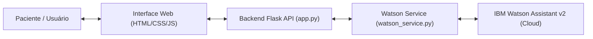
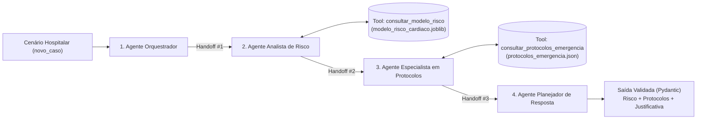
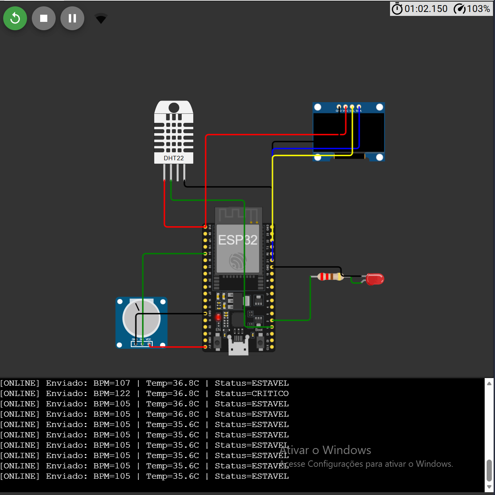
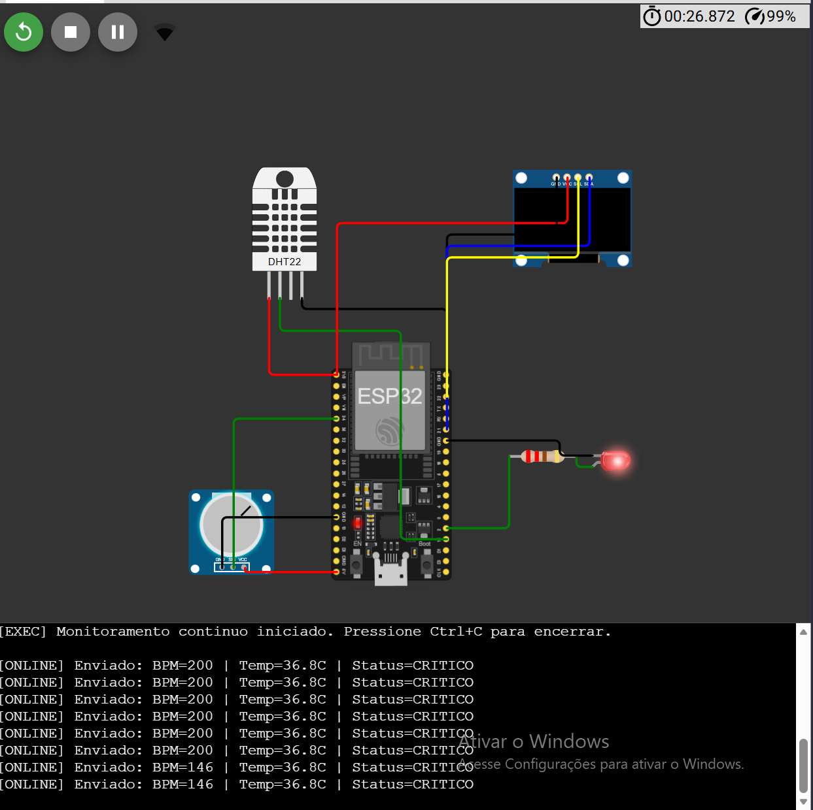

# FIAP - Projeto CardioIA

**Turma** 

2TIAOA-2026

**Instrutor**

Caique Nonato da Silva Bezerra

**Integrantes do grupo**
* Davi Santos Ferreira
* Lais Kurahashi
* Lucas Martinelli

---  

# Organização do projeto

* **backend:** Núcleo integrador da plataforma CardioIA em Python (`backend/app.py` e `backend/integrador_service.py`), unificando a ingestão de telemetria IoT com os motores de IA das Fases 4, 5 e 6, e suíte de testes de integração (`backend/test_integrador.py`).
* **iot:** Firmware do microcontrolador ESP32 em MicroPython (`iot/main.py`), driver OLED (`iot/ssd1306.py`), diagrama de conexões do Wokwi (`iot/diagram.json`) e simulador de telemetria (`iot/simulador_iot.py`).
* **web:** Aplicação Web moderna em React + Vite publicada na Vercel com CI/CD automático, rotas SPA (`web/vercel.json`), tela de análise de ECG e nova tela de Telemetria & Risco em tempo real.
* **config:** Centraliza arquivos de configuração, mapeamento de sintomas (.csv), dicionários de regras, diagramas, os pesos dos modelos CNN salvos (`.pth`), a exportação do Watson Assistant (`watson_assistant_skill.json`), o modelo preditivo de risco cardíaco da Fase 6 (`modelo_risco_cardiaco.joblib`) e os protocolos clínicos de emergência (`protocolos_emergencia.json`).
* **docs:** Reservada para a base de conhecimento textual e documentação técnica, incluindo relatórios do ESP32, Node-RED, Watson Assistant, Relatório da Fase 6 e o **Relatório Técnico Oficial da Arquitetura Final de 5 páginas** (`docs/Relatorio_Integracao_Arquitetura_Final_Fase7.pdf`).
* **scripts:** Contém os notebooks (.ipynb), script de treinamento CNN (`cardioia_treinamento_cnn.py`), protótipo Streamlit (`cardioia_prototype.py`), código C++ do ESP32 (`skecth_esp32.ino`), serviço do Watson (`watson_service.py`), backend Flask (`app.py`), sistema multiagente preditivo (`sistema_multiagente_fase6.py`), geradores de PDFs e suítes de testes.
* **templates / static:** Interface web interativa e dashboards em tempo real.
* **temp:** Diretório destinado a arquivos gerados durante a execução, logs de processamento e tabelas de testes temporárias.
* **assets:** Armazena os ativos do projeto, dados cardiologia (`heart.csv`), base sintética de 5.000 casos (`base_sintetica_risco_fase6.csv`), exames de ECG e imagens de dashboards.
* **requirements.txt / requirements-backend.txt:** Listagem de todas as bibliotecas Python necessárias para execução do ecossistema.
* **main.bat:** Script inicializador automatizado interativo para Windows com menu de opções para as Fases 4, 5, 6 e 7.

---  

# 🏥 CardioIA – A Era da Cardiologia Inteligente

## 📖 Proposta de Projeto:

As doenças cardiovasculares são a principal causa de morte no mundo, com cerca de 17,9 milhões de óbitos anuais. O projeto CardioIA surge para revolucionar a cardiologia, criando uma plataforma digital interativa que simula um ecossistema hospitalar moderno. O objetivo é integrar ciência de dados e inteligência artificial para antecipar eventos críticos e personalizar o cuidado ao paciente.

## 📌 Objetivos do Projeto
* Impacto Social: Simular a prática hospitalar com dados reais.

* Soluções Tecnológicas: Desenvolver sistemas de triagem digital, diagnósticos assistidos por IA, monitoramento via IoT e assistentes virtuais (chatbots).

## 📂 Estrutura da Fase 1: Curadoria de Dados: 

Batimentos de Dados (Mapeando o Coração Moderno)Nesta fase inicial, o foco é a construção de uma base de dados sólida e a discussão sobre governança e ética em IA.

1. **Dados Numéricos (IoT):** Utilizaremos um conjunto de dados com variáveis clínicas para identificar perfis de risco.
    * Justificativa Técnica: Fatores como idade avançada, hipertensão e diabetes são os principais preditores de desfechos cardiovasculares negativos.
    * Aplicação em IA: Esses dados alimentarão classificadores supervisionados para identificar riscos de doenças na Fase 2.

2.  **Dados Textuais (NLP):** Exploração de artigos científicos e dados epidemiológicos do Brasil.
    * Texto 1: Estudo sobre a associação entre estilo de vida (tabagismo, dieta) e risco cardiovascular no Brasil.
    * Texto 2: Estudo de coorte de 10 anos sobre a frequência de eventos cardíacos em pacientes com condições inflamatórias crônicas (Artrite Reumatoide) usando dados do DATASUS.
    * Aplicação em NLP: O Processamento de Linguagem Natural permitirá a extração de sintomas e a criação de chatbots de orientação ao paciente na Fase 5.

3. **Dados Visuais (Visão Computacional):** Coleta de imagens de exames diagnósticos, como Eletrocardiogramas (ECG).
    * Justificativa Técnica: A análise visual automatizada é crucial para detectar arritmias e anomalias de forma precoce.
    * Aplicação em VC: Na Fase 4, treinaremos modelos de visão computacional para interpretar padrões e criar módulos de visualização diagnóstica.

Aqui está o conteúdo das novidades da Fase 2 estruturado em formato Markdown para você copiar e colar diretamente no seu arquivo README.md.

Markdown
## 🤖 Fase 2 – Inteligência e Diagnóstico Automatizado

Nesta etapa, o **CardioIA** avançou para o desenvolvimento de motores de decisão, transformando os dados brutos coletados na Fase 1 em diagnósticos assistidos por modelos de Machine Learning.

### Desenvolvimento das partes
* **Fontes de dados:**
    * Mapa de doenças: A listagem dos sintomas e doenças ficou por parte da Lais Kurahashi
    * Frases: A listagem das Frases ficou por parte do Lucas Martinelli
    * Base de treinamento de triagem: Base desenvolvida3 utilizando o Gemini.

1. **Diagnóstico por Ontologia e Machine Learning (Parte 1)**
Desenvolvemos um sistema capaz de interpretar relatos clínicos e sugerir possíveis patologias com base em um mapa de conhecimento médico estruturado.

* **Implementação:** Foram realizados testes entre os modelos de **Random Forest (Floresta Aleatória)** e **Árvore de Decisão (Decision Tree)** para processar as descrições dos pacientes e buscar a melhor correspondência no mapa de 100 doenças cadastradas.
* **Diferencial Técnico:** Implementamos técnicas de **NLP (Processamento de Linguagem Natural)**, como a limpeza de ruídos (remoção de acentos/pontuação) e o uso de *N-grams* no vetorizador TF-IDF.
    * **Resultado:** Isso permite que a IA identifique expressões complexas como "dor no peito" ou "falta de ar" em vez de apenas palavras isoladas, aumentando a precisão do diagnóstico sugerido.
* **Testes Realizados**
    * **Random Forest (Floresta Aleatória)**: O Random Forest Classifier apresentou um resultado bastante coeso com relação aos sintomas apresentados no mapa de 100 doenças, se tornando também a alterantiva mais facil de manipular e realizar os testes.
    * **Árvore de Decisão (Decision Tree):** Foram feitos alguns testes utilizando o modelo de Decision Tree, entretanto, para esse caso os resultados se apresentaram super confusos e irrealistas, mesmo realizando manipulação e normalização dos dados.

2. **Classificador de Triagem: Alto vs. Baixo Risco (Parte 2)**
Implementamos um classificador estatístico focado na priorização de atendimentos, simulando protocolos reais de triagem clínica.

* **Tecnologia:** Uso de **Vetorização TF-IDF** para transformar texto em dados numéricos e também modelos como o **Árvore de Decisão (Decision Tree)** e **Logistic Regression** para a lógica de classificação.
* **Governança de Dados:** Os modelos foram treinados para identificar gatilhos de emergência, garantindo que sintomas críticos sejam classificados como "Alto Risco", essencial para a responsabilidade ética no desenvolvimento de IAs para a saúde.

### 📹 Demonstração e Avaliação
* **Análise de Performance:** O modelo demonstrou eficácia na detecção de padrões de risco, embora a acurácia reflita a necessidade de bases de dados maiores para lidar com a subjetividade dos relatos humanos.
* **Vídeo de Demonstração:** [[Link Youtube Capitulo 2 CARDIO IA](https://youtu.be/xBCWgkPsdxc)]

---

## 🚀 Fase 3: Monitoramento em Tempo Real e Resiliência IoT

### Desenvolvimento das partes
* **Fontes de dados:**
    * ESP32: Lais Kurahashi
    * Conexão MQTT e configurações: Lucas Martinelli
    * Git Hub: Davi Ferreira
    * NODE-RED: Davi Ferreira

Nesta fase do projeto **CardioIA**, implementamos a integração completa entre a camada Edge e a nuvem (Cloud/Fog), garantindo que o monitoramento do paciente seja contínuo, mesmo em situações de falha de conectividade.

Observação: Os processos de sensores feitos nessa fase, foram relaizados com base em uma simulação do ESP32 na Wokwi

### 🛠️ O que foi implementado:
1. **Edge Computing (ESP32):**
   - Programação em C++ para leitura de Sensores de Temperatura (DHT22) e Frequência Cardíaca (Simulada via Potenciômetro).
   - **Lógica de Resiliência:** Implementação de um buffer local que armazena os sinais vitais caso o Wi-Fi caia, sincronizando-os automaticamente ao recuperar a conexão.
   - **Alerta Local:** Acionamento de LED físico para triagem imediata de anomalias (BPM > 120 ou Temp > 38°C).

2. **Cloud & Conectividade (MQTT):**
   - Configuração do protocolo MQTT via Broker HiveMQ para transmissão de dados em formato JSON.
   - Comunicação assíncrona entre o simulador Wokwi e o servidor local.

3. **Interface e Inteligência (Node-RED):**
   - Criação de um Dashboard interativo com gráficos de tendência e medidores instantâneos.
   - **Motor de Regras:** Nós de desvio condicional que disparam notificações visuais no painel ao detectar estados críticos de saúde.

### 📂 Estrutura de Arquivos desta Fase

Os arquivos referentes a esta etapa estão organizados nos seguintes diretórios:

* **Documentação:**
    * [`Relatorio_ESP32.pdf`](./docs/Relatorio_ESP32.pdf) - Detalhamento da arquitetura de borda e resiliência.
    * [`Relatorio_Node-RED.pdf`](./docs/Relatorio_Node-RED.pdf) - Explicação da camada de nuvem, MQTT e lógica de alertas.
* **Scripts e Configurações:**
    * [`skecth_esp32.ino`](./scripts/skecth_esp32.ino) - Código fonte C++ do microcontrolador.
    * [`ESP32_diagram.json`](./config/ESP32_diagram.json) - Diagrama de conexões do simulador.
* **Assets:**
    * Imagens e prints do funcionamento do Dashboard estão na pasta [`/assets`](./assets).

### 🌐 Simulação Online (Wokwi)

O protótipo funcional pode ser testado diretamente no navegador através do link abaixo:

🔗 **[Projeto CardioIA no Wokwi](https://wokwi.com/projects/463793755500080129)**

---

## 🧠 Fase 4: Inteligência e Visão Computacional (CNNs)

Nesta fase, expandimos o motor de diagnósticos lógicos do CardioIA para classificar imagens de Eletrocardiograma (ECG), diferenciando exames normais (Classe N) de anomalias (Classe M).

### Desenvolvimento e Modelagem
Desenvolvemos e avaliamos duas abordagens de Redes Neurais Convolucionais usando o framework **PyTorch** para processar exames de ECG redimensionados para `224x224` pixels:

#### 1. CNN do Zero (Scratch CNN)
Trata-se de uma rede neural convolucional profunda e otimizada, desenvolvida do absoluto zero:
*   **Camada de Entrada:** Imagem em escala RGB de dimensões `3 x 224 x 224`.
*   **Extrator de Features (Blocos Convolucionais):**
    *   **Bloco 1:** `Conv2D(3 -> 16 canais, kernel=3, padding=1)` + `ReLU` + `MaxPool2d(kernel=2, stride=2)` $\rightarrow$ Reduz a dimensão para `16 x 112 x 112`.
    *   **Bloco 2:** `Conv2D(16 -> 32 canais, kernel=3, padding=1)` + `ReLU` + `MaxPool2d(kernel=2, stride=2)` $\rightarrow$ Reduz a dimensão para `32 x 56 x 56`.
    *   **Bloco 3:** `Conv2D(32 -> 64 canais, kernel=3, padding=1)` + `ReLU` + `MaxPool2d(kernel=2, stride=2)` $\rightarrow$ Reduz a dimensão para `64 x 28 x 28`.
*   **Camada Classificadora (Fully Connected):**
    *   `Flatten` para vetorizar as saídas das convoluções em um array unidimensional de `50.176` neurônios.
    *   `Linear(50176 -> 128 neurônios)` + `ReLU` + `Dropout(p=0.5)` para prevenir o sobreajuste (overfitting).
    *   `Linear(128 -> 2 neurônios de saída)` mapeando para as classes finalistas (Normal e Anomalia).

#### 2. Transfer Learning (ResNet50)
Um modelo avançado baseado em aprendizado por transferência de conhecimento:
*   **Base:** Arquitetura `ResNet50` carregada com pesos pré-treinados da base ImageNet.
*   **Congelamento (Freezing):** Todos os pesos originais do extrator de features da ResNet50 foram congelados (`requires_grad = False`). Isso nos permite reaproveitar filtros visuais robustos de bordas e texturas já consolidados.
*   **Cabeça de Classificação:** A camada de saída original (`fc`) foi substituída por uma nova camada linear adaptada para nosso cenário: `nn.Linear(2048 -> 2 neurônios de saída)`. Apenas esta camada foi deixada livre para o aprendizado dos gradientes.

### Resultados e Métricas de Teste
Os modelos foram validados no conjunto de teste independente contendo 115 exames de ECG e alcançaram classificação perfeita:

| Métrica | CNN do Zero | ResNet50 Transfer Learning |
| :--- | :---: | :---: |
| **Acurácia** | 1.0000 | 1.0000 |
| **Precisão** | 1.0000 | 1.0000 |
| **Recall (Sensibilidade)** | 1.0000 | 1.0000 |
| **F1-Score** | 1.0000 | 1.0000 |

*As matrizes de confusão e o gráfico do histórico de perdas/acurácia estão salvos na pasta `/assets`.*

### Protótipo de Apresentação Interativa (Streamlit)

Criamos uma aplicação web local de demonstração em poucas linhas de código usando o framework **Streamlit** para fins de homologação e apresentação do sistema hospitalar:
*   **Seletor de Modelos:** Permite alternar dinamicamente na barra lateral do painel entre os pesos do modelo *CNN do Zero* (`~25MB`) e do *ResNet50 Transfer Learning* (`~94MB`).
*   **Seleção de Imagens de Teste:** Varre o diretório de testes e exibe os exames disponíveis para a escolha do médico/usuário.
*   **Visualização e Inferência:** Exibe o exame selecionado na tela e, ao clicar em **"Analisar Exame"**, exibe o laudo estilizado contendo a predição da IA (**Padrão Identificado: Normal** em verde ou **Padrão Identificado: Anomalia Detectada** em vermelho) acompanhado do percentual exato de certeza.

### Como Executar o Aplicativo
1.  **Inicialização Rápida (Recomendado):**
    Execute o arquivo `main.bat` na raiz do projeto. Ele se encarregará de ler o `requirements.txt`, instalar todas as bibliotecas necessárias automaticamente e iniciar a interface Streamlit.
    ```powershell
    .\main.bat
    ```
2.  **Execução Manual:**
    ```powershell
    pip install -r requirements.txt
    streamlit run scripts/cardioia_prototype.py
    ```
    O aplicativo abrirá no seu navegador padrão em `http://localhost:8501`.


---

## 💬 Fase 5: Assistente Cardiológico Conversacional (IBM Watson Assistant & Flask API)

Na Fase 5, o ecossistema **CardioIA** avança para o desenvolvimento de um **Assistente Cardiológico Conversacional (Chatbot)**, capaz de orientar pacientes, interpretar relatos clínicos em linguagem natural, esclarecer dúvidas de exames e simular protocolos reais de triagem hospitalar.

### 👥 Divisão de Atividades
* **Lais Kurahashi:** Modelagem Conversacional no IBM Watson Assistant (Intenções, Entidades e Árvore de Decisão), exportação JSON da Skill e Relatório Técnico e Conceitual de Saúde.
* **Davi Ferreira:** Desenvolvimento do Backend em Python (Flask), integração com a API v2 do Watson Assistant, construção e integração da interface web conversacional, gerenciamento de sessões, governança técnica do repositório, bateria de testes automatizados e roteiro de validação.

---

### 🏗️ Arquitetura da Solução Conversacional



1. **Camada de Inteligência e NLP (IBM Watson Assistant):**
   * **12 Intenções (`#intents`):** `#saudacao`, `#relatar_sintoma`, `#preparo_exame`, `#agendamento`, `#consultar_resultado`, `#entender_resultado`, `#prazo_entrega`, `#informar_pressao`, `#informar_frequencia`, `#pedir_orientacao`, `#falar_com_atendente`, `#despedida`.
   * **6 Entidades (`@entities`):** `@tipo_exame` (*ecocardiograma, holter, mapa, eletrocardiograma, teste ergometrico*), `@sintomas` (*dor_peito, falta_de_ar, palpitacao, etc.*), `@duvida_resultado`, `@tipo_orientacao`, `@sys-date`, `@sys-time`.
   * **61 Nós de Diálogo:** Árvore de decisão com desambiguação clínica, confirmação dinâmica de agendamentos e transbordo para atendente humano.
   * **Governança e Ética:** O assistente não realiza diagnósticos médicos definitivos, focando em acolhimento empático, triagem preventiva e orientação segura.

2. **Camada de Integração Backend (Python + Flask):**
   * Módulo desacoplado `WatsonAssistantService` em [`scripts/watson_service.py`](./scripts/watson_service.py).
   * Servidor Flask REST em [`scripts/app.py`](./scripts/app.py) com CORS habilitado e gerenciamento de sessões e reconexão automática.
   * Arquivo de configuração de credenciais via variáveis de ambiente (`.env`).

3. **Interface de Interação com o Usuário:**
   * Aplicação web responsiva estilizada em [`templates/index.html`](./templates/index.html), com chat em tempo real, indicador de digitação (*typing indicator*), botões de sugestão rápida (*chips*) e alerta ético de uso.

---

### 🔌 Documentação da API REST

| Método | Endpoint | Descrição | Exemplo de Payload |
| :--- | :--- | :--- | :--- |
| `GET` | `/api/status` | Health Check da API e status da conexão com Watson | N/A |
| `POST` | `/api/session` | Cria uma nova sessão no Watson Assistant v2 | N/A |
| `POST` | `/api/message` | Envia mensagem do paciente e recebe o laudo de resposta | `{"session_id": "...", "message": "Estou sentindo dor no peito"}` |
| `DELETE` | `/api/session/<id>` | Encerra e desaloca a sessão aberta no Watson | N/A |

---

### 🧪 Bateria de Testes Automatizados

O projeto inclui uma suíte automatizada de testes clínicos em [`scripts/test_watson_api.py`](./scripts/test_watson_api.py) cobrindo:
1. **Health Check da API** (Status 200 e Watson conectado).
2. **Ciclo de Vida de Sessão** (Criação e desalocação).
3. **Fluxo de Boas-Vindas** (`#saudacao`).
4. **Triagem Clínica Crítica** (`#relatar_sintoma` com `@sintomas:dor_peito`).
5. **Preparo de Exame** (`#preparo_exame` com `@tipo_exame:holter`).
6. **Agendamento Cardiológico** (`#agendamento` com `@tipo_exame:ecocardiograma`).
7. **Transbordo para Atendente Humano** (`#falar_com_atendente`).

Para executar a bateria de testes:
```powershell
python scripts/test_watson_api.py
```

---

### 🚀 Como Executar o CardioIA (Fase 5)

1. **Inicialização Automatizada (Recomendado):**
   Execute o script `main.bat` na raiz do projeto e selecione a opção `[1]` para iniciar o Chatbot ou `[3]` para rodar os testes:
   ```powershell
   .\main.bat
   ```
   Acesse a interface no navegador em: **`http://localhost:5000`**

2. **Execução Manual da API:**
   ```powershell
   pip install -r requirements.txt
   python scripts/app.py
   ```

---

## 🫀 Fase 6: Coração Sob Controle – Gestão de Crises com Sistema Preditivo e Arquitetura Multiagente

Na **Fase 6**, o projeto **CardioIA** atinge maturidade de comando hospitalar ao integrar **Ciência de Dados Preditiva (Machine Learning)** a uma **Arquitetura Multiagente Autônoma (OpenAI Agents SDK)** para prever picos de risco cardiovascular e acionar protocolos clínicos de contingência de maneira estruturada e auditável.

### 👥 Divisão de Atividades (Fase 6)
* **Lais Kurahashi (Parte 1 – Modelo Preditivo e Protocolos):** Geração da base sintética com 5.000 cenários hospitalares, treinamento e comparação de modelos supervisionados (Regressão Logística, Gradient Boosting e Random Forest), avaliação de métricas e calibração (Brier Score), serialização do modelo `.joblib`, estruturação dos 10 protocolos de emergência (`.json`) e elaboração do Relatório Técnico do Modelo Preditivo (2 páginas).
* **Davi Santos Ferreira (Parte 2 – Arquitetura Multiagente, Automação e Governança):** Desenvolvimento do Sistema Multiagente com **OpenAI Agents SDK** (4 agentes especializados, *tools*, *handoffs*, histórico de mensagens e validação Pydantic), documento de Arquitetura Multiagente em PDF (3 páginas), suíte de testes automatizados (`test_multiagente_fase6.py`), menu interativo (`main.bat`) e documentação técnica.

---

### 📊 Parte 1: Modelo Preditivo de Risco Cardíaco (`RandomForestClassifier`)

A base sintética ([`assets/base_sintetica_risco_fase6.csv`](./assets/base_sintetica_risco_fase6.csv)) possui **5.000 registros** e **10 variáveis preditivas** (`idade_media`, `carga_sistema`, `tempo_espera`, `fc_media`, `spo2_media`, `pa_sistolica`, `temperatura`, `densidade_eventos`, `eventos_24h`, `disponibilidade_recursos`) para estimar a variável-alvo `pico_risco` (`0 = Normal`, `1 = Alerta Crítico`).

| Modelo Avaliado | Acurácia | Precisão | Recall (Sensibilidade) | F1-Score | Brier Score |
| :--- | :---: | :---: | :---: | :---: | :---: |
| **Random Forest (Escolhido)** | **0.9990** | **1.0000** | **0.9962** | **0.9981** | **0.0058** |
| Gradient Boosting | 0.9980 | 0.9962 | 0.9962 | 0.9962 | 0.0019 |
| Regressão Logística | 0.8160 | 0.6146 | 0.8233 | 0.7038 | 0.1232 |

* **Artefatos da Parte 1:**
  * Notebook de Treinamento: [`scripts/CardioIA_Modelo_Preditivo_Fase6.ipynb`](./scripts/CardioIA_Modelo_Preditivo_Fase6.ipynb)
  * Modelo Serializado: [`config/modelo_risco_cardiaco.joblib`](./config/modelo_risco_cardiaco.joblib)
  * Protocolos de Emergência (10 regras): [`config/protocolos_emergencia.json`](./config/protocolos_emergencia.json)
  * Relatório Técnico (2 páginas): [`docs/Relatorio_Modelo_Preditivo_Fase6.pdf`](./docs/Relatorio_Modelo_Preditivo_Fase6.pdf) / [`docs/Relatorio_Modelo_Preditivo_Fase6.rtf`](./docs/Relatorio_Modelo_Preditivo_Fase6.rtf)

---

### 🤖 Parte 2: Arquitetura Multiagente (`OpenAI Agents SDK`)

Implementada em [`scripts/sistema_multiagente_fase6.py`](./scripts/sistema_multiagente_fase6.py), a arquitetura coordena **4 agentes especializados** conectados via **Handoffs**, **Tools** e **Validação Pydantic (`output_type=RecomendacaoFinalCardioIA`)**:



1. **Agente Orquestrador:** Recebe o cenário hospitalar, normaliza chaves de entrada (tratando automaticamente variações como `"disponibilidade recursos"` com espaço para `"disponibilidade_recursos"`), inicializa o histórico de mensagens e transfere o controle ao Analista de Risco.
2. **Agente Analista de Risco:** Executa a *tool* `consultar_modelo_risco` sob o modelo `.joblib`, obtendo a classe prevista (`pico_risco`) e a probabilidade (`score_risco`), classifica a severidade (`BAIXO`, `MODERADO` ou `ALTO`) e realiza *handoff* para o Especialista em Protocolos.
3. **Agente Especialista em Protocolos:** Executa a *tool* `consultar_protocolos_emergencia` sob os 10 protocolos oficiais em `.json`, cruzando os indicadores vitais/operacionais e o score de risco, e realiza *handoff* para o Planejador de Resposta.
4. **Agente Planejador de Resposta:** Consolida o plano de contingência final validado pelo schema Pydantic `RecomendacaoFinalCardioIA`.

* **Documento de Arquitetura Multiagente (3 páginas):** [`docs/Arquitetura_Multiagente_Fase6.pdf`](./docs/Arquitetura_Multiagente_Fase6.pdf)

---

### 📋 Exemplo Real de Entrada e Saída (`novo_caso` Oficial FIAP)

**Entrada (`novo_caso`):**
```python
novo_caso = {
    "idade_media": 62, "carga_sistema": 92, "tempo_espera": 75,
    "fc_media": 118, "spo2_media": 89, "pa_sistolica": 100,
    "temperatura": 37.5, "densidade_eventos": 7, "eventos_24h": 5,
    "disponibilidade_recursos": 25
}
```

**Saída Estruturada Gerada pelo Sistema Multiagente:**
```text
Risco previsto: ALTO (score: 0.96)
Ações recomendadas:
- Se carga do sistema > 85% → abrir unidades temporárias
- Se disponibilidade_recursos < 30% → redistribuir insumos
- Se densidade_eventos > 6 → ativar plano de contingência
- Se risco sistêmico alto → ativar estado de emergência
Justificativa:
O modelo Random Forest previu classe pico_risco=1 com probabilidade estimada de 0.96 (96%), caracterizando estado de ALERTA CRÍTICO hospitalar. Os indicadores operacionais demonstram sobrecarga severa da rede (carga do sistema em 92% > 85%, disponibilidade de recursos reduzida a 25% < 30% e densidade de eventos em 7 > 6), combinada a estresse fisiológico relevante dos pacientes monitorados (FC média de 118 bpm, SpO2 média de 89% e tempo de espera de 75 min). Diante dessa convergência, 4 protocolos oficiais de contingência foram acionados simultaneamente para abertura imediata de unidades temporárias, redistribuição de insumos críticos e decretação de estado de emergência.
```

---

### 🚀 Como Executar e Testar a Fase 6

1. **Pelo Menu Interativo (`main.bat`):**
   ```powershell
   .\main.bat
   ```
   * Escolha `[1]` para executar o **Sistema Multiagente Preditivo** (permite testar o Cenário Oficial FIAP, Baixo Risco ou Colapso Crítico).
   * Escolha `[2]` para rodar a **Bateria de Testes Automatizados da Fase 6**.

2. **Pelo Terminal (Linha de Comando):**
   ```powershell
   # Executar o fluxo multiagente completo no caso oficial da FIAP
   python scripts/sistema_multiagente_fase6.py --cenario padrao

   # Testar outros cenários (baixo_risco ou critico) ou exportar JSON completo
   python scripts/sistema_multiagente_fase6.py --cenario baixo_risco
   python scripts/sistema_multiagente_fase6.py --cenario critico --json

   # Executar os 7 testes automatizados de validação da Fase 6
   python scripts/test_multiagente_fase6.py
   ```

---

### 📹 Vídeo de Demonstração (Fase 6)
* **Link do Vídeo no YouTube (Não Listado):** **[FIAP - Cardio IA - Fase 6 (https://youtu.be/ZiV1SSPbsR0)](https://youtu.be/ZiV1SSPbsR0)**
* **Repositório Oficial no GitHub:** **[https://github.com/Raquerd/FIAP_Project_CardioIA](https://github.com/Raquerd/FIAP_Project_CardioIA)**

---

# Fase 7 – Deploy, Integração Web e Aplicativo Mobile

## 1. Visão geral da entrega

Nesta etapa, o CardioIA foi ampliado com uma aplicação Web e um aplicativo Mobile integrados a um backend responsável pela autenticação e pelo processamento das imagens de eletrocardiograma (ECG).

**Tecnologias utilizadas:**

| Componente | Tecnologia |
|---|---|
| Frontend Web | React e Vite |
| Aplicativo Mobile | React Native e Expo |
| Backend | Python e Flask |
| Servidor WSGI | Gunicorn |
| Inteligência artificial | CNN e ResNet50 |
| Autenticação | Supabase |
| Histórico Web | IndexedDB |
| Hospedagem Web | Vercel |
| Hospedagem do backend | AWS Elastic Beanstalk |
| Build Mobile | Expo Application Services (EAS) |

## 2. Links para avaliação

- **Vídeo de Demonstração da Fase 7 (YouTube):** https://youtu.be/BRGNv5NzkT0
- **Aplicação Web publicada (Vercel SPA com CI/CD ativo):** https://fiap-project-cardio-ia-delta.vercel.app
- **Aplicativo Android (APK via EAS Build):** [[Baixar CardioIA](https://expo.dev/artifacts/eas/5-zVREEnJZ6c7p0Ryhjkn65hlqBnIuC4IfWS9qX_5JI.apk)](https://expo.dev/accounts/laykura/projects/cardioia-mobile/builds/c17470c5-3da4-40c6-aa25-ef0d2f3db23c)
  
- **Projeto Mobile no Expo:** https://expo.dev/accounts/laykura/projects/cardioia-mobile
- **Simulação de Hardware IoT em MicroPython (Wokwi):** https://wokwi.com/projects/480358266952735745
- **Relatório Técnico Oficial da Arquitetura Final (PDF de 5 Páginas):** [`docs/Relatorio_Integracao_Arquitetura_Final_Fase7.pdf`](./docs/Relatorio_Integracao_Arquitetura_Final_Fase7.pdf) (ou na raiz: [`Relatorio_Integracao_Arquitetura_Final_Fase7.pdf`](./Relatorio_Integracao_Arquitetura_Final_Fase7.pdf))

## 3. Aplicação Web

A aplicação Web está publicada na Vercel:

https://fiap-project-cardio-ia-delta.vercel.app

O frontend permite realizar autenticação, selecionar imagens de ECG, escolher o modelo de inteligência artificial e visualizar os resultados retornados pelo backend.

O histórico da aplicação Web utiliza IndexedDB, armazenando as análises localmente no navegador.

O arquivo `web/vercel.json` configura o encaminhamento das requisições destinadas à API para o backend hospedado na AWS e o fallback para as rotas da aplicação frontend.

## 4. Backend e infraestrutura AWS

O backend foi desenvolvido em Flask e hospedado no AWS Elastic Beanstalk.

- Aplicação: `cardioia`
- Ambiente: `cardioia-env`
- Região: `us-east-2` (Ohio)

**Endpoint base:**

http://cardioia-env.eba-unfydca4.us-east-2.elasticbeanstalk.com

Entre as rotas disponibilizadas estão:

| Método | Rota | Finalidade |
|---|---|---|
| GET | `/api/status` | Verificar a disponibilidade da API e diagnóstico de todos os módulos |
| POST | `/api/telemetria` | Receber sinais vitais do ESP32 MicroPython e acionar inferência preditiva de risco |
| GET | `/api/telemetria/atual` | Retornar o último sinal vital registrado para os cards da interface |
| GET | `/api/telemetria/historico` | Retornar as últimas leituras de telemetria para gráficos de tendência |
| POST | `/api/predicao/risco` | Avaliar risco cardiovascular em tempo real com Random Forest (Fase 6) |
| POST | `/api/ecg/analisar` | Receber a imagem e executar a análise do ECG com CNN ou ResNet50 |
| POST | `/api/message` | Processar mensagens conversacionais com o Watson Assistant (Fase 5) |
| GET | `/api/integracao/resumo` | Resumo técnico em tempo real dos 4 pilares do ecossistema integrado |

A rota de análise exige autenticação por token Bearer do Supabase, recebe a imagem por multipart/form-data e permite selecionar o modelo `cnn` ou `resnet50`.

O resultado contém a classificação e as probabilidades calculadas pelo modelo utilizado.

O arquivo `Procfile` configura a inicialização do backend com Gunicorn.

## 5. Aplicativo Mobile

O aplicativo foi desenvolvido com React Native e Expo.

- Nome: CardioIA
- Identificador Android: `br.com.cardioia.mobile`
- Projeto Expo: `cardioia-mobile`

### Funcionalidades

- Cadastro e autenticação de usuários.
- Persistência da sessão com Supabase.
- Seleção de imagens de ECG na galeria do dispositivo.
- Seleção entre os modelos CNN e ResNet50.
- Envio da imagem ao backend autenticado.
- Exibição da classificação e das probabilidades retornadas pela API.
- Navegação entre as telas de início, análise, histórico e conta.

O envio da imagem utiliza `expo-file-system/legacy`, com requisição multipart/form-data e token de acesso no cabeçalho `Authorization`.

### Build Android

O APK foi gerado pelo Expo Application Services (EAS), utilizando o perfil `preview`, com distribuição interna.

Para gerar um novo APK:

```bash
cd mobile
npm install
npx eas-cli build --platform android --profile preview
```

A configuração de build está em `mobile/eas.json`, e os dados do aplicativo estão em `mobile/app.json`.

### Como baixar o CardioIA

**Requisitos:** celular com sistema Android e conexão com a internet.

1. Abra o link **Baixar CardioIA (APK)** pelo navegador do celular.
2. Toque em **Baixar** para fazer o download do aplicativo.
3. Aguarde o download terminar.
4. Abra o arquivo baixado, chamado CardioIA.apk ou semelhante.
5. Se o Android exibir um aviso de segurança, toque em **Configurações** e permita a instalação de aplicativos dessa fonte (por exemplo, Chrome).
6. Volte para a tela de instalação e toque em **Instalar**.
7. Quando a instalação terminar, toque em **Abrir**.
8. Faça login ou crie uma conta para começar a utilizar o CardioIA.

**Observação:** o aplicativo é distribuído por arquivo APK, fora da Google Play Store. Por isso, o Android poderá solicitar autorização para instalar aplicativos de fontes externas.

## 6. Autenticação e variáveis de ambiente

O Supabase é utilizado para autenticação dos usuários.

### Aplicativo Mobile

As seguintes variáveis são utilizadas:

| Variável | Finalidade |
|---|---|
| `EXPO_PUBLIC_API_URL` | Endereço base da API |
| `EXPO_PUBLIC_SUPABASE_URL` | Endereço do projeto Supabase |
| `EXPO_PUBLIC_SUPABASE_PUBLISHABLE_KEY` | Chave publicável do Supabase |

### Backend

| Variável | Finalidade |
|---|---|
| `SUPABASE_URL` | Endereço do projeto Supabase |
| `SUPABASE_PUBLISHABLE_KEY` | Chave utilizada na validação da autenticação |
| `PORT` | Porta de execução do servidor |

As variáveis devem ser configuradas no ambiente de execução correspondente. Arquivos `.env` com valores locais não devem ser versionados.

## 7. Histórico de análises

Na aplicação Web, as análises são armazenadas localmente no navegador por meio do IndexedDB.

No aplicativo Mobile, a tela de histórico consulta os registros da tabela `exams` no Supabase. O fluxo atual de análise Mobile, entretanto, não grava automaticamente o resultado nessa tabela. Portanto, os históricos Web e Mobile não são sincronizados nesta versão.

## 8. Execução local

### ⚡ Inicialização Rápida e Automatizada (`main.bat`)

Para facilitar a execução de todo o ecossistema integrado em ambiente Windows, utilize o inicializador interativo na raiz do repositório:

```powershell
.\main.bat
```

O menu disponibiliza atalhos rápidos para todos os módulos do projeto:
- **`[0] Iniciar Solução Completa (Recomendado)`:** Inicializa o Backend Integrador em janela dedicada, abre o Hub Web no navegador (`http://localhost:5000`) e dispara a simulação de telemetria IoT automaticamente com 1 clique.
- **`[1] Iniciar Backend Integrador (Fase 7)`:** Inicializa o servidor Flask unificado em segundo plano sem travar o terminal.
- **`[2] Executar Testes Automatizados de Integração (Fase 7)`:** Executa os 7 testes de integração do ecossistema (`backend/test_integrador.py`).
- **`[3] Executar Simulador IoT MicroPython (Fase 7)`:** Transmite pacotes de telemetria simulando o ESP32 (com auto-detecção do backend).
- **`[4] Gerar Relatório Técnico em PDF (5 Páginas)`:** Compila o relatório oficial da arquitetura da Fase 7 via ReportLab.
- **`[5] Abrir Hub Web da Solução`:** Abre `http://localhost:5000` diretamente no navegador padrão.
- **`[6] Executar Sistema Multiagente (Fase 6)`:** Inicia a orquestração multiagente da Fase 6 no terminal.
- **`[7] Abrir Dashboard Web da Fase 6`:** Abre o painel HTML interativo de simulação multiagente.
- **`[8] Executar Testes do Multiagente (Fase 6)`:** Executa os testes automatizados da Fase 6.
- **`[9] Iniciar Chatbot Conversacional (Fase 5)`:** Inicia o assistente cardiológico integrado ao Watson.
- **`[10] Iniciar Protótipo Streamlit de ECG (Fase 4)`:** Executa o visualizador de exames e inferência CNN.

---

### Execução Manual por Componente

#### 1. Backend Integrador e Hub Web Local

Na raiz do repositório:

```bash
pip install -r requirements.txt
python backend/app.py
```

O backend integrado estará disponível em:
- **Hub Web Interativo:** `http://localhost:5000`
- **Health Check & Diagnóstico:** `http://localhost:5000/api/status`
- **Telemetria Atual (JSON):** `http://localhost:5000/api/telemetria`
- **Resumo da Integração:** `http://localhost:5000/api/integracao/resumo`

#### 2. Simulador IoT MicroPython (Resiliente)

Para injetar sinais vitais no backend sem necessidade da placa física:

```bash
# Envio padrão de 10 pacotes com intervalo de 2s (cenário aleatório)
python iot/simulador_iot.py

# Cenários específicos (estavel, taquicardia, bradicardia, febre)
python iot/simulador_iot.py --cenario taquicardia --qtd 5 --intervalo 1
```

*Nota: O simulador verifica automaticamente se o backend local em `http://localhost:5000` está ativo. Caso esteja desligado, ele inicializa o processo do backend em segundo plano de forma autônoma. Se a execução local não estiver disponível, faz fallback transparente para a nuvem AWS.*

#### 3. Frontend Web (React + Vite)

Em outro terminal:

```bash
cd web
npm install
npm run dev
```

Acesse em `http://localhost:5173`. Para compilar o build de produção:

```bash
npm run build
```

#### 4. Aplicativo Mobile (React Native + Expo)

Em outro terminal:

```bash
cd mobile
npm install
npx expo start
```

Para gerar o APK Android, consulte o comando apresentado na seção de build.

## 9. Segurança e limitações

- As rotas protegidas da API validam o token de autenticação do Supabase.
- Credenciais e arquivos `.env` não devem ser publicados no repositório.
- A comunicação configurada entre a Vercel e o backend AWS utiliza HTTP, não HTTPS de ponta a ponta.
- O histórico Web é local ao navegador; o histórico Mobile consulta o Supabase, sem gravação automática pelo fluxo atual de análise.
- Os modelos e resultados apresentados fazem parte de um protótipo acadêmico, sem validação clínica para utilização diagnóstica.

**Aviso:** o CardioIA é um projeto acadêmico e experimental. Seus resultados não substituem avaliação médica e não devem ser utilizados isoladamente para decisões clínicas.

## 10. Demonstração da aplicação

### Hardware IoT e Simulação no Wokwi (ESP32 MicroPython)

A simulação completa do hardware hospitalar com microcontrolador ESP32 rodando MicroPython foi homologada no simulador Wokwi, conectando sensores de sinais vitais, display OLED I2C de telemetria e sinalização física de emergência:

* **Cenário 1: Monitoramento Estável (BPM normal e sem alertas):**
  O display OLED exibe `STATUS: ESTAVEL`, batimentos dentro da faixa fisiológica normal e o LED de alerta permanece desligado.

  

* **Cenário 2: Detecção de Risco Crítico / Taquicardia (BPM > 120):**
  O firmware em MicroPython detecta anomalia em tempo de máquina (<5ms), aciona o LED vermelho de emergência no pino GPIO 2 e atualiza o display OLED para `STATUS: ! ALERTA !`.

  

🔗 **Acesse o simulador ao vivo:** [Simulação ESP32 MicroPython no Wokwi](https://wokwi.com/projects/480358266952735745)

### Aplicação Web


### Aplicativo Mobile


### Infraestrutura


---

## 🚀 11. Fase 7 - Parte 2: Integração do Ecossistema, MicroPython & Arquitetura Final

Desenvolvido por **Davi Santos Ferreira** como parte da entrega final do MVP integrado do CardioIA.

### 🔌 1. Transição de Hardware para MicroPython (ESP32 no Wokwi)
- **Migração de Firmware:** A lógica anterior em C/C++ foi convertida integralmente para **MicroPython** no arquivo [`iot/main.py`](./iot/main.py) com o driver [`iot/ssd1306.py`](./iot/ssd1306.py).
- **Sensoriamento Clínico:**
  - **Frequência Cardíaca (BPM):** Leitura do ADC no pino `GPIO 34` (potenciômetro) mapeado linearmente para o intervalo fisiológico de **40 a 200 BPM**.
  - **Temperatura e Umidade:** Leitura digital via sensor **DHT22** no pino `GPIO 15`.
- **Feedback Visual Local (Duplo):**
  - **Display OLED SSD1306 (I2C SDA=21, SCL=22):** Resolução 128x64 exibindo BPM, Temperatura, Status Clínico (`ESTAVEL`, `ATENCAO` ou `! ALERTA !`) e status da rede/buffer.
  - **LED Vermelho de Alerta (GPIO 2):** Acionamento físico em tempo de máquina (<5ms) caso BPM > 120 ou Temp > 38,0 °C.
- **Edge Computing & Resiliência Offline:**
  - Buffer circular local em RAM com retenção de até **20 medições** caso o Wi-Fi ou Broker MQTT oscilem.
  - Sincronização automática em lote assim que a conexão é restabelecida (`sincronizar_buffer()`).
- **Simulação Online no Wokwi:** [Link do Projeto MicroPython no Wokwi](https://wokwi.com/projects/480358266952735745).

### 🧠 2. Núcleo Integrador Backend em Python (`backend/`)
- Serviço central implementado em [`backend/app.py`](./backend/app.py) e [`backend/integrador_service.py`](./backend/integrador_service.py) que unifica:
  - **Telemetria de Sensores:** Recebe pacotes do MicroPython (`POST /api/telemetria`) e mantém histórico em memória.
  - **Motor Preditivo da Fase 6:** Inferência instantânea com o modelo Random Forest (`config/modelo_risco_cardiaco.joblib`), calculando probabilidade e pico de risco.
  - **Protocolos de Emergência:** Avaliação automática das 10 diretrizes clínicas de [`config/protocolos_emergencia.json`](./config/protocolos_emergencia.json) disparadas conforme os sinais vitais.
  - **Visão Computacional da Fase 4:** Classificação de imagens de ECG com CNN e ResNet50 (`POST /api/ecg/analisar`).
  - **Assistente Conversacional da Fase 5:** Gerenciamento de sessões e chat com o Watson Assistant (`POST /api/message`).

### 🖥️ 3. Hub Web Local (`templates/fase7_hub.html`) vs Aplicação Web Cloud (`web/`)
O ecossistema dispõe de duas interfaces web complementares com propósitos bem definidos:
- **Aplicação Web em Produção (Vercel):** Aplicação SPA em React + Vite voltada para o corpo clínico e pacientes. Foco em triagem, autenticação Supabase, laudos de ECG por visão computacional e visualização gráfica de telemetria.
- **Hub Web Local (`http://localhost:5000`):** Painel de controle operacional e sala de comando integrada ao backend Flask. Exibe medidores em tempo real dos sinais vitais, monitora os protocolos hospitalares disparados pela telemetria, permite disparar injeções de teste e inspeciona a integridade das conexões e modelos de IA.

### 📊 4. Nova Tela de Telemetria & Risco na Aplicação Web
- Adicionada aba **"Telemetria & Risco"** no menu principal da aplicação Web (React + Vite), contendo:
  - Cards em tempo real com indicador de pulso para Frequência Cardíaca (BPM), Temperatura Corporal (°C) e Status do ESP32.
  - Painel com o Score de Risco do Random Forest e lista de Protocolos de Emergência acionados.
  - Barra de ferramentas para simulação rápida de cenários clínicos (Estável, Taquicardia/Crise e Bradicardia).
  - Tabela com o histórico das últimas leituras recebidas do sensor.

### 🧪 5. Testes Automatizados de Integração
Bateria de 7 testes de integração desenvolvida em [`backend/test_integrador.py`](./backend/test_integrador.py) com **100% de aprovação**:
```bash
python backend/test_integrador.py
```
- `test_01_health_check_status`: Verificação de saúde de todos os módulos [OK]
- `test_02_recebimento_telemetria_micropython_normal`: Ingestão estável (BPM 76) [OK]
- `test_03_recebimento_telemetria_micropython_alerta_critico`: Alerta crítico (BPM 138) [OK]
- `test_04_consulta_ultimo_sinal_iot`: Consulta do último sinal vital [OK]
- `test_05_consulta_historico_iot`: Histórico para gráficos de tendência [OK]
- `test_06_predicao_risco_personalizada`: Inferência com o Random Forest da Fase 6 [OK]
- `test_07_resumo_integracao_completa`: Diagnóstico holístico da plataforma integrada [OK]

### 📑 6. Relatório Técnico Oficial da Arquitetura Final (PDF de 5 Páginas)
O documento técnico exigido pela FIAP detalhando o fluxo `Sensor -> MicroPython -> Backend Python -> APIs de IA -> UI` está disponível em:
- **[`docs/Relatorio_Integracao_Arquitetura_Final_Fase7.pdf`](./docs/Relatorio_Integracao_Arquitetura_Final_Fase7.pdf)** *(e na raiz do projeto: [`Relatorio_Integracao_Arquitetura_Final_Fase7.pdf`](./Relatorio_Integracao_Arquitetura_Final_Fase7.pdf))*.

### 📹 7. Vídeo de Demonstração (Fase 7)
- **Link do Vídeo no YouTube:** **[FIAP - Cardio IA - Fase 7 (https://youtu.be/BRGNv5NzkT0)](https://youtu.be/BRGNv5NzkT0)**


